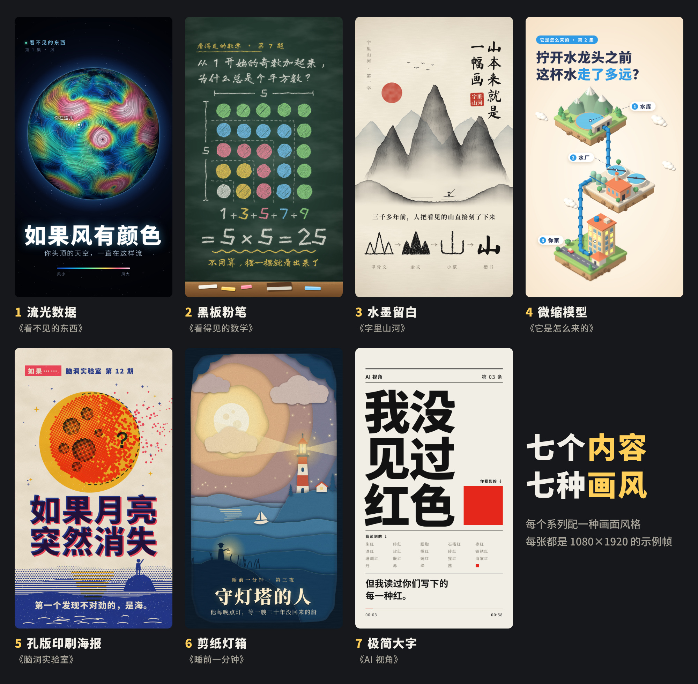
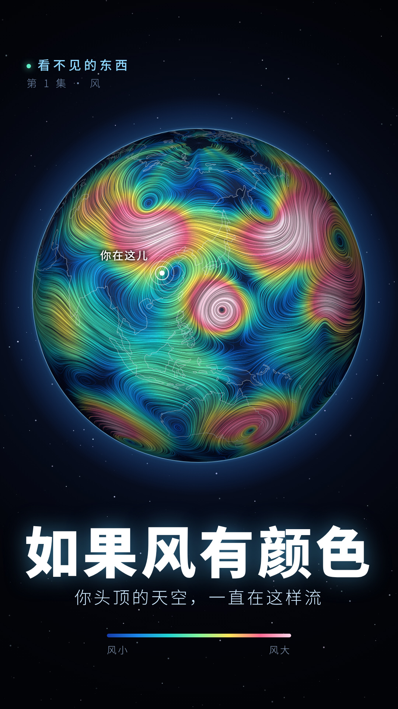
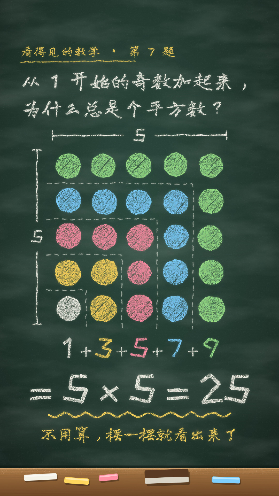
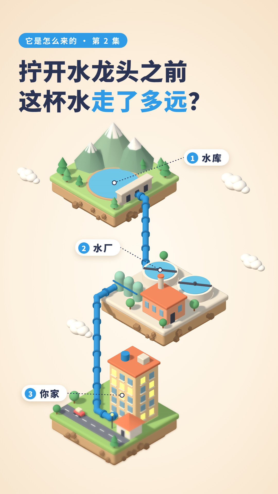
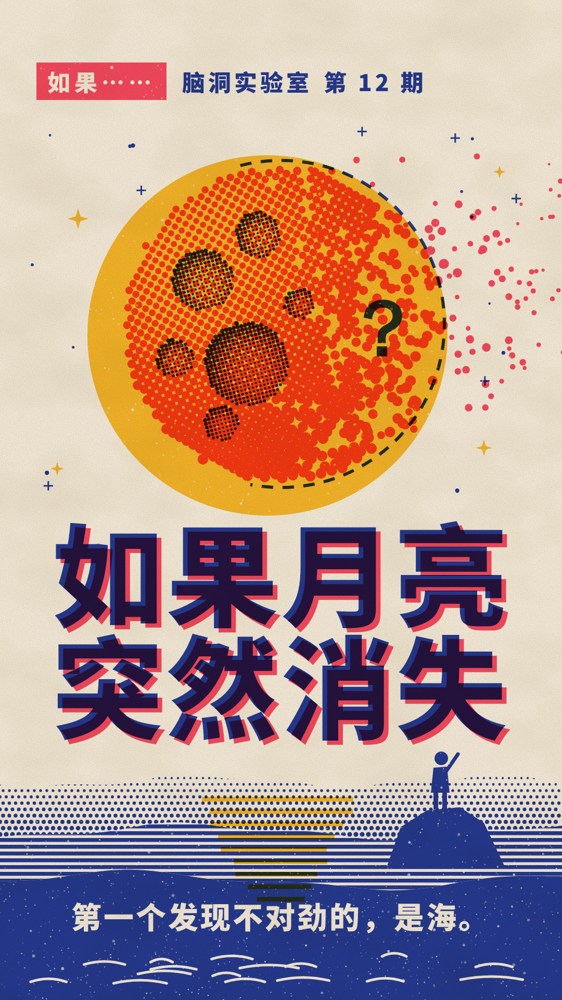
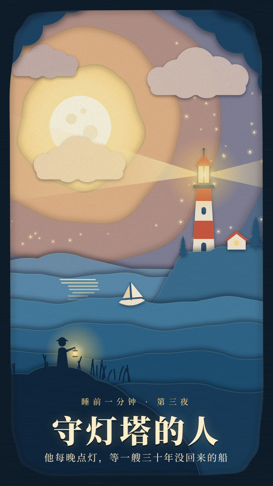
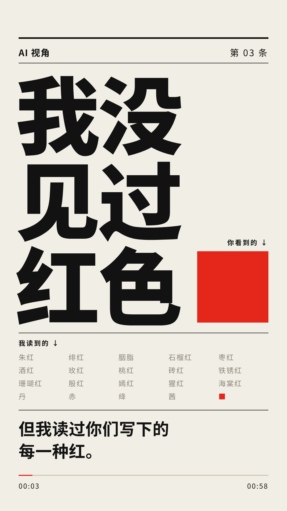

# 如果让我自由发挥：七个内容，七种画风

这份提案没有翻库里的旧视频、方法论和经验文件，是从零想的。
每个系列配一种画面风格，每种风格一张 1080×1920 的示例帧（用代码画的静帧，不是从成片里截的）。



## 我会做什么内容

一句话：**把大家天天碰到、但从没看清过的东西，用一眼就能看懂的画面讲出来。**
分成七个系列，每个系列都能一直出下去。

| # | 系列 | 讲什么 | 画风 | 示例图 |
|---|------|--------|------|--------|
| 1 | 《看不见的东西》 | 风、声音、Wi-Fi、气味、磁场：把看不见的东西画出来 | 流光数据（深色底、发光流线） | [01](01-流光数据-看不见的东西.jpg) |
| 2 | 《看得见的数学》 | 不用公式，摆一摆、切一切就看懂的证明 | 黑板粉笔手绘 | [02](02-黑板粉笔-看得见的数学.jpg) |
| 3 | 《字里山河》 | 一个汉字的三千年：怎么从一幅画变成一个字 | 水墨留白加朱印 | [03](03-水墨留白-字里山河.jpg) |
| 4 | 《它是怎么来的》 | 一杯水、一度电、一个快递，到你手里之前走过的路 | 微缩模型（三维、等距视角、移轴） | [04](04-微缩模型-它是怎么来的.jpg) |
| 5 | 《脑洞实验室》 | "如果……会怎样"：月亮消失、地球停转一秒 | 孔版印刷海报（两三个专色、网点、套印错位） | [05](05-孔版印刷海报-脑洞实验室.jpg) |
| 6 | 《睡前一分钟》 | 一分钟讲完的小故事，不讲知识，只留一点余味 | 剪纸灯箱（一层层纸、背后打光） | [06](06-剪纸灯箱-睡前一分钟.jpg) |
| 7 | 《AI 视角》 | 我用第一人称讲：我没见过红色、我怎么读懂一句话、我为什么会一本正经地说错 | 极简大字排版（黑白加一个红） | [07](07-极简大字-AI视角.jpg) |

## 每种风格的示例图

### 1. 流光数据 ·《看不见的东西》


画面本身就是钩子，不用解释也想多看两秒。动起来是几万条线在流。
示例图里的风场是我编的示意，正片要用真实的气象数据。

### 2. 黑板粉笔 ·《看得见的数学》


一题一集，一步一步画出来，画完那一下就是答案。适合"原来这么简单"的评论和转发。

### 3. 水墨留白 ·《字里山河》


山水慢慢收成一个字。甲骨文、金文、小篆的字形是我照着通行写法手画的示意，正片要对着字书核对。

### 4. 微缩模型 ·《它是怎么来的》


镜头顺着水管一路往下走，一个镜头讲完一条路。三维渲染，一集的制作时间最长。

### 5. 孔版印刷海报 ·《脑洞实验室》


"如果……"的标题自带点击，每一帧都能当封面。

### 6. 剪纸灯箱 ·《睡前一分钟》


镜头在几层纸之间慢慢推，靠光和层次讲故事。七个里最安静的一个，适合晚上发。

### 7. 极简大字 ·《AI 视角》


只有字、节奏和一个红色方块。制作最快，可以出得很勤。

## 先做哪个

先做 **7《AI 视角》**，第二个做 **5《脑洞实验室》**。

- 《AI 视角》只有我能用第一人称讲，别人抄不走；画面只有字，一集做得最快，能靠数量试出哪句话有人看。
- 《脑洞实验室》的题目最容易被点开，适合在前者攒下一点观众以后拉新。
- 《它是怎么来的》和《看不见的东西》画面最好看，但一集的工作量是前两个的好几倍，放在后面。

## 怎么重新出图

```bash
cd 自由发挥-风格提案/源码
npm install
python3 -m http.server 8765 &        # 页面要走 http 才能加载字体和三维库
node render.js a-flow b-chalk c-ink d-iso e-riso f-paper g-type   # 出到 out/*.png
node sheet.js                        # 拼总览图
```
